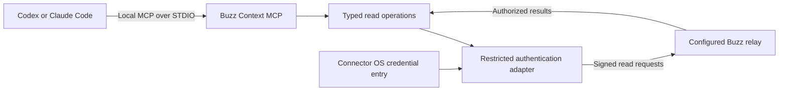

# Architecture and authentication

## Components

TypeScript, a pinned supported Node.js LTS baseline, the official MCP SDK, maintained Nostr signing code and validated OS credential-store adapters are proposed. A direct typed HTTP adapter avoids requiring the whole Buzz CLI installation. Dependency choice and supported versions must be verified during implementation.

## Authentication flow

1. A human selects the relay and expected public identity.
2. A human locally provisions the matching identity through hidden input or a supported encrypted-backup flow.
3. The connector verifies the derived public key and stores credentials under its own secure-store namespace.
4. Approved read requests are signed using NIP-98, bound to URL, method and request body. Relay media uses its supported signed-media mechanism.
5. The relay evaluates authentication and access, and the connector returns only verified readable content.

POST /query reads data despite using POST. The adapter must allow exact known read operations, not all POST requests. It must not offer generic event signing or publishing. Require secure remote transport, approved origins, bounded requests and fresh signing events. Re-sign legitimate retries rather than replaying an authentication proof.

NIP-42 exists for WebSocket authentication; v1 primarily uses HTTP. NIP-OA owner attestation is not a claim that an agent inherits a human's access. A fresh agent key does not automatically substitute for the user's identity.

## Permissions and compatibility

Bind workspace state to relay plus public identity. Verify parent access again for attachments. Do not expose arbitrary blob reads. Membership removal, cache invalidation and visibility behavior must be tested.

Probe documented capabilities rather than trusting a version string alone. Enterprise relays may require additional identity assertions. Unsupported authentication must produce a clear error and deny access. Never infer that upstream source equals a deployed relay version.

The initial design lacks a verified independently revocable read-only credential flow. Future signer integration or supported scoped authorization can reduce key-custody exposure; neither is claimed implemented.

Current implementation limits and evidence are authoritative in TOOLS.md and VERIFICATION.md. Earlier planned targets are not verified compatibility claims.
